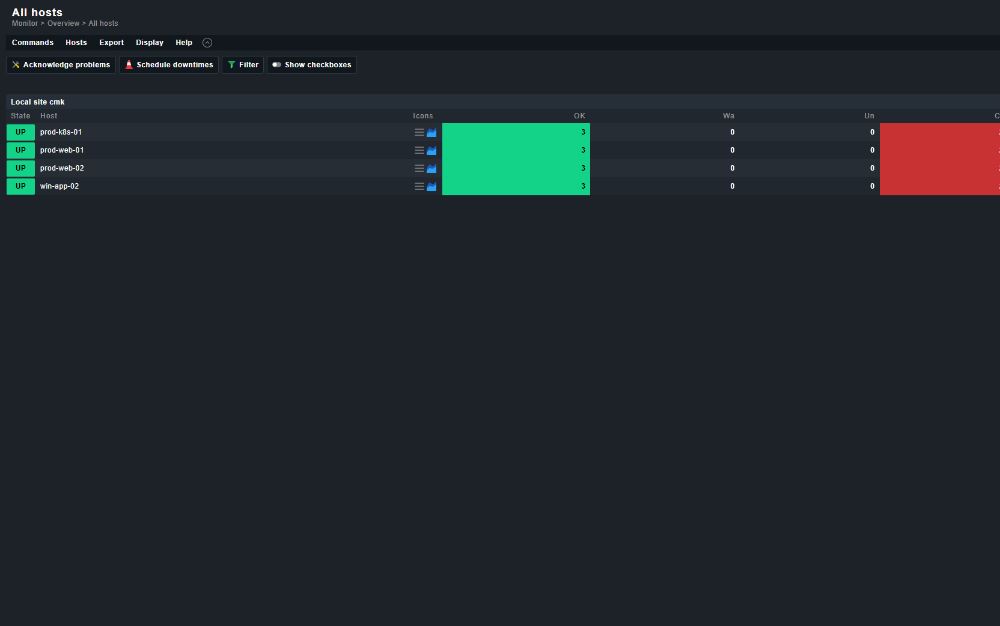
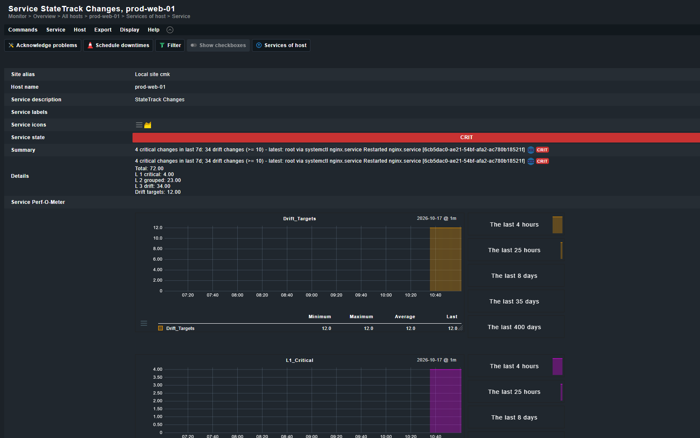

# StateTrack × Checkmk

Monitor StateTrack's change activity as a first-class Checkmk service, using
either the **local check** mechanism or a **Nagios-compatible active check**.

`check_statetrack.py` is a single Python 3 script with **no third-party
dependencies** — drop it on a monitored host or a Checkmk poller and run it. It
polls the unified host summary endpoint:

```
GET {base}/api/v1/hosts/{host}/summary?window={window}
```

**Want to see it first?** There is a complete Docker demo with four hosts, both
check modes and live data: [`§4 Local Docker demo`](#4-local-docker-demo).
One command (`.\scripts\dev.ps1 checkmk`) brings it up at
`http://localhost:5000/cmk/` (`cmkadmin` / `statetrack`).

**Contents**

1. [What operators see in Checkmk](#1-what-operators-see-in-checkmk)
2. [Mode 1 — Local check](#2-mode-1--local-check-recommended)
3. [Mode 2 — Nagios / MRPE / Icinga2](#3-mode-2--nagios--mrpe--icinga2-active-check)
4. [Local Docker demo](#4-local-docker-demo)
5. [All options](#5-all-options)
6. [Metrics](#6-metrics)
7. [Troubleshooting](#7-troubleshooting)
8. [Tests](#8-tests)

For deploying the agent that feeds this check, see
[`docs/agent-deployment-guide.md`](../../docs/agent-deployment-guide.md).

---

## 1. What operators see in Checkmk

Each monitored host gets **one service per mode**:

| Service | Mode | Where it comes from |
| ------- | ---- | ------------------- |
| `StateTrack Changes` | local check | `check_statetrack.py --mode local`, run by the Checkmk agent |
| `StateTrack Active Check` | Nagios active check | `check_statetrack.py --mode nagios`, run by the core |

Both compute state from the *same* document with the *same* thresholds, so they
only disagree when the two execution paths do (a stale agent cache vs. a live
poll) — which is itself a useful signal.

### What it looks like

The all-hosts view — four demo hosts, each with two CRIT services and no host
down:



The service detail — state, summary with actor and target, the clickable deep
link, and the perfdata breakdown:



### Service states

| State | Shown as | Condition |
| ----- | -------- | --------- |
| **OK (0)** | green | Agent online, no critical changes, drift below the WARN threshold. |
| **WARN (1)** | yellow | `l1_critical` reached `--warn-critical`, or `l3_drift` reached `--warn-drift` (default 5), or tracked targets reached `--warn-targets`. |
| **CRIT (2)** | red | Agent **offline**, or `l1_critical` reached `--crit-critical` (default 1), or `l3_drift` reached `--crit-drift` (default 10). |
| **UNKNOWN (3)** | grey | Connectivity or configuration failure — server unreachable, timeout, rejected token, unknown hostname. |

Two deliberate choices:

- **Offline outranks everything.** A silent agent means changes are no longer
  being captured, so its state is CRIT even if the window is otherwise clean.
- **Connection failures are UNKNOWN, not CRITICAL.** A StateTrack outage must
  not page the on-call engineer as a production incident. The message names the
  cause so the monitoring team can act on it.

### Status detail: actor, target, and a clickable deep link

The CRIT detail line names *who* changed *what*, and ends with the console deep
link so one click lands on the diff. On a host page it looks like this:

```
4 critical changes in last 7d; 34 drift changes (>= 10) - latest:
  root via systemctl nginx.service Restarted nginx.service
  [6cb5dac0-ae21-54bf-afa2-ac780b18521f]
  http://localhost:5173/events/6cb5dac0-...?tab=diff            CRIT
```

(The formatting above is for illustration; live output is the same text on one
clickable line, truncated at Checkmk's service-details width.)

The raw local-check line that produced it:

```
2 "StateTrack Changes" total=72|l1_critical=4;1;1|l2_grouped=23|l3_drift=34;5;10|drift_targets=12 \
  4 critical changes in last 7d; 34 drift changes (>= 10) - latest: root via systemctl ...
```

### The five performance metrics

Every state — including OK — ships perfdata, so the graphs are populated from
the first check and Checkmk draws the thresholds as reference lines:

| Metric | Unit | Meaning | Thresholds attached |
| ------ | ---- | ------- | ------------------- |
| `total` | changes | All root changes in the window (`l1 + l2 + l3 + l4`). | — |
| `l1_critical` | changes | Critical configuration / identity / service mutations. | `;warn;crit` |
| `l2_grouped` | changes | Aggregated transactions (package operations, CM runs). | — |
| `l3_drift` | changes | Drift-only changes. | `;warn;crit` |
| `drift_targets` | targets | Configuration targets currently tracked on the host. | — (see `--warn-targets`) |

In the GUI these appear as the **Service Perf-O-Meter** plus per-metric graphs
(`Total`, `L1_Critical`, `L2_Grouped`, `L3_Drift`, `Drift_Targets`) over the last
4 hours, 25 hours, 8 days, 35 days and 400 days.

> Checkmk only starts drawing a graph after a second data point, so the first
> few minutes of a fresh install show a single value and no line. That is
> Checkmk's RRD cadence, not a bug in the check.

### Targeted watcher events in the detail line

The demo fleet carries two **surgical watcher** events, so a recording shows the
integration reacting to the same alerts the console does:

| Host | Watched object | Change | Level |
| ---- | -------------- | ------ | ----- |
| `win-app-02` | `iis://apppool/CheckoutAppPool` | `state: Started → Stopped`, identity switched to `CORP\svc_checkout` (`InetMgr.exe`, `CORP\Administrator`) | L1 Critical |
| `prod-web-01` | `db://postgres/settings_db/tables/public.app_settings` | `payment_gateway.verify_tls: true → false`, Stripe webhook secret rotated (`psql`, `dba_sarah`, `10.0.14.22`) | L1 Critical |

Both appear in the Checkmk detail line as ordinary critical changes — the check
counts events, it does not need to know which collector produced them:

```
2 critical changes in last 7d; ... - latest:
  dba_sarah via psql modified db://postgres/settings_db/tables/public.app_settings
  [0000279c-...]
```

The value is in the pairing: Checkmk shows *that* a host crossed a threshold,
StateTrack's service detail and deep link show *which pool stopped* or *which
config row flipped*, without a second tool. See
[§5 of the deployment guide](../../docs/agent-deployment-guide.md#5-targeted-watchers-files-directories-iis-pools--databases)
for how each target is configured.

---

## 2. Mode 1 — Local check (recommended)

A local check is the least intrusive deployment: the Checkmk agent executes the
script during its own run and pipes its stdout into the check results. No
special privileges, no Checkmk-side configuration.

### Deploy

```bash
# On the monitored host
sudo install -m 0755 check_statetrack.py /usr/lib/check_mk_agent/local/60/check_statetrack.py
```

The filename's position determines the service group and, in a numbered
subdirectory, the execution interval in seconds: `local/60/` runs it once a
minute, `local/300/` once every five minutes. To place it in a named group:

```bash
sudo install -m 0755 check_statetrack.py /usr/lib/check_mk_agent/local/statetrack
```

> The path differs per agent flavour — `/usr/lib/check_mk_agent/local/` on
> Debian/Ubuntu and RHEL, and the **msi** equivalent on Windows
> (`C:\ProgramData\checkmk\agent\local\`). See the Checkmk docs for your agent.

### Configure

The script reads both flags and environment variables, so credentials can live
in the agent environment rather than world-readable argv:

```bash
sudo tee /etc/check_mk/statetrack.env >/dev/null <<'EOF'
STATETRACK_URL=https://statetrack.example.com
STATETRACK_TOKEN=st_live_xxxxxxxxxxxxxxxx
STATETRACK_HOST=$(hostname -s)
EOF
sudo chmod 0600 /etc/check_mk/statetrack.env
```

Then wrap if you prefer explicit flags (write a small shell shim in `local/`):

```bash
#!/bin/sh
# /usr/lib/check_mk_agent/local/check_statetrack
. /etc/check_mk/statetrack.env
exec /usr/bin/python3 /opt/statetrack/check_statetrack.py \
    --mode local \
    --url "$STATETRACK_URL" \
    --host "${STATETRACK_HOST:-$(hostname -s)}" \
    --token "$STATETRACK_TOKEN" \
    --window 15m
```

### Execution interval (caching)

Local checks re-run on **every** Checkmk agent run, which is every 60 seconds by
default. That is more traffic than this check needs, and the state changes
slowly, so cache it.

Newer agents support a per-plugin interval in the plugin's own header:

```bash
#!/bin/sh
# -*- coding: utf-8 -*-
# interval: 300
```

If your agent version ignores `interval`, cache in the wrapper — atomically, so
the agent never reads a half-written file:

```bash
CACHE=/var/lib/check_mk/statetrack.cache
if [ ! -s "$CACHE" ] || [ "$(find "$CACHE" -mmin +5)" ]; then
    /opt/statetrack/check_statetrack.py --mode local \
        --url "$STATETRACK_URL" --host "$STATETRACK_HOST" --token "$STATETRACK_TOKEN" \
        > "$CACHE.tmp" && mv "$CACHE.tmp" "$CACHE"
fi
cat "$CACHE"
```

**Always print a line, even on failure.** A local check that prints nothing
disappears from Checkmk (which looks like a deleted service); the script emits
an UNKNOWN line instead, so the service stays visible with a clear reason.

### Verify

```bash
# Straight from the agent's point of view
sudo -u checkmk /usr/lib/check_mk_agent/local/60/check_statetrack.py | head -3

# The script on its own
python3 check_statetrack.py --url http://localhost:8080 --host prod-web-01
# 0 "StateTrack_Changes" total=5|l1_critical=0;1;1|... Agent online, 0 critical changes in last 15m
```

The service appears under **StateTrack_Changes** (or
**statetrack / StateTrack_Changes** if you used a subdirectory). The check
parameter rule **"StateTrack_Changes"** can then set thresholds per host tag.

---

## 3. Mode 2 — Nagios / MRPE / Icinga2 active check

Use this when a *polling* supervisor owns the check rather than the agent: the
Nagios core, Checkmk's **Active checks (HTTP, TCP, …)** or Checkmk's **MRPE**
wrapper, Icinga2, or any `check_*`-compatible runner.

It prints the Nagios plugin protocol and exits with the standard codes:

```
STATETRACK OK - Agent online, 0 critical changes in last 15m | total=5 l1_critical=0;1;1 l2_grouped=1 l3_drift=3;5;10 drift_targets=2
```

| Exit code | State |
| --------- | ----- |
| `0` | OK |
| `1` | WARNING |
| `2` | CRITICAL |
| `3` | UNKNOWN |

### Checkmk MRPE

Add to `/etc/check_mk/mrpe.cfg` on the **Checkmk server**:

```
StateTrack_Changes /opt/statetrack/check_statetrack.py --mode nagios --url https://statetrack.example.com --host $HOSTADDRESS$ --token st_xxx
```

`$HOSTADDRESS$` is substituted by Checkmk per host, so one MRPE line covers the
whole fleet — provided the monitored address resolves to the StateTrack
hostname. If it does not, use a macro or a host-specific line.

### Checkmk Active check (HTTP)

1. **Setup → Services → HTTP, TCP, Email, … → Active checks (HTTP, TCP, …)**
2. Command: `check_statetrack.py`
3. Arguments, one per field:

   ```
   --mode|nagios|--url|https://statetrack.example.com|--host|$HOSTNAME$|--token|st_xxx
   ```

4. Set **Service check command** to the plugin name and the **Check interval**
   to `5` minutes.

### Checkmk "Integrate Nagios plug-ins" rule

The same thing expressed as a WATO rule — this is what the Docker demo
provisions programmatically, and it is the easiest form to template across a
fleet:

**Setup → Services → Other services → Integrate Nagios plug-ins**

- *Service description*: `StateTrack Active Check`
- *Command line*:

  ```
  /omd/sites/cmk/local/bin/check_statetrack.py --mode nagios \
      --url http://host.docker.internal:8080 \
      --host $HOSTNAME$ --window 7d
  ```

- *Conditions*: host name matches your target hosts.

`$HOSTNAME$` is substituted per host by the core, so one rule covers the fleet.
Because a command line is a shell-adjacent string, quote any service name that
contains spaces.

### Icinga2 CheckCommand

```conf
object CheckCommand "statetrack" {
  command = [ "/opt/statetrack/check_statetrack.py" ]

  arguments = {
    "--mode"   = { value = "nagios" }
    "--url"    = { value = "$statetrack_url$" }
    "--host"   = { value = "$host.name$" }
    "--token"  = { value = "$statetrack_token$" }
    "--window" = { value = "$statetrack_window$" }
  }

  vars.statetrack_url    = "https://statetrack.example.com"
  vars.statetrack_window = "15m"
}

apply Service "statetrack-changes" {
  check_command = "statetrack"
  vars.statetrack_token = host.vars.statetrack_token
  assign where host.vars.statetrack_token
}
```

Run `icinga2 daemon -C` after editing; Icinga2 refuses to start on a malformed
`CheckCommand`.

### Verify

```bash
python3 check_statetrack.py --mode nagios --url http://localhost:8080 --host prod-web-01
echo "exit=$?"   # 0 OK / 1 WARNING / 2 CRITICAL / 3 UNKNOWN
```

---

## 4. Local Docker demo

A complete Checkmk Raw site, provisioned with four hosts, both check modes and
live data from your running StateTrack server — enough to film the integration
end to end without touching a production monitoring server.

### Bring it up

```powershell
# From the repository root. Starts the container, provisions Checkmk, verifies.
.\scripts\dev.ps1 checkmk
```

Or step by step:

```powershell
docker compose --profile monitoring up -d checkmk
.\scripts\provision_checkmk.ps1
```

The `checkmk` service sits behind the `monitoring` compose profile so a plain
`docker compose up` does not spend a minute creating a site nobody asked for.
Naming the service explicitly (`up -d checkmk`) bypasses the profile.

### Log in

| | |
| --- | --- |
| URL | <http://localhost:5000/cmk/> |
| User | `cmkadmin` |
| Password | `statetrack` |

The password is fixed by `CMK_PASSWORD` in `docker-compose.yml`. It is a demo
site on a loopback port; do not reuse that value anywhere reachable.

### What the provisioning script configures

For each of `prod-web-01`, `win-app-02`, `prod-k8s-01`, `prod-web-02`:

1. **The host object**, with no real agent — a datasource program replaces agent
   access entirely.
2. **A `datasource_programs` rule** pointing at
   `/omd/sites/cmk/local/bin/statetrack_agent_wrapper.sh <host>`. The wrapper
   emits a valid `<<<check_mk>>>` header, then `<<<local:sep(0)>>>`, then runs
   `check_statetrack.py --mode local`. Result: the **`StateTrack Changes`**
   service.
3. **A `custom_checks` rule** ("Integrate Nagios plug-ins") running
   `check_statetrack.py --mode nagios`. Result: the **`StateTrack Active Check`**
   service, so both integration modes are visible on one screen.

It then activates the changes, runs service discovery (`cmk -II`), forces a check
cycle (`cmk --check`) and verifies through Livestatus that every service reached
OK/CRIT with all five perfdata metrics.

Everything is **idempotent** — re-running updates the objects it owns and leaves
the rest of the site alone.

### Recording checklist

| Step | Where |
| ---- | ----- |
| Hosts overview showing 4 hosts, 8 problems | **Monitor → Overview → All hosts** |
| Both StateTrack services per host, CRIT in red | **Monitor → Overview → All hosts → prod-web-01** |
| Actor, target, summary and deep link | click **`StateTrack Changes`** |
| Five perfdata graphs | same page, **Service graphs** |
| The raw local check | `docker exec statetrack-checkmk-1 /omd/sites/cmk/local/bin/statetrack_agent_wrapper.sh prod-web-01` |
| The raw active check | `docker exec statetrack-checkmk-1 /omd/sites/cmk/local/bin/check_statetrack.py --mode nagios --url http://host.docker.internal:8080 --host prod-web-01 --window 7d` |

### Useful flags

```powershell
.\scripts\provision_checkmk.ps1 -NoStart      # site already running
.\scripts\provision_checkmk.ps1 -Recreate     # wipe the site volume, start clean
.\scripts\provision_checkmk.ps1 -SkipVerify   # provision only
.\scripts\provision_checkmk.ps1 -StateTrackUrl http://host.docker.internal:8081
```

### How it reaches StateTrack

The container talks to the host through `host.docker.internal`, mapped by
`extra_hosts: ["host.docker.internal:host-gateway"]`. That is built in on Docker
Desktop and supplied explicitly for Linux. Confirm the path from inside the
container:

```bash
docker exec statetrack-checkmk-1 curl -fsS http://host.docker.internal:8080/healthz
```

If your server runs on another port, pass `-StateTrackUrl`.

### Tuning the demo

The wrapper and the active check read these from the environment:

| Variable | Default | Effect |
| -------- | ------- | ------ |
| `STATETRACK_URL` | `http://host.docker.internal:8080` | StateTrack base URL. |
| `STATETRACK_WINDOW` | `7d` | Lookback window. `7d` makes the seeded timeline visible; production usually wants `15m`. |
| `STATETRACK_TOKEN` | *(empty)* | Bearer token, if the API requires one. |
| `STATETRACK_SERVICE` | `StateTrack Changes` | Service name reported by the local check. |

---

## 5. All options

| Flag | Env | Default | Purpose |
| ---- | --- | ------- | ------- |
| `--mode` | — | `local` | `local` (Checkmk) or `nagios` (active/MRPE/Icinga2). |
| `--url` | `STATETRACK_URL` | `http://localhost:8080` | StateTrack base URL. |
| `--host` | `STATETRACK_HOST` | this machine's hostname | Hostname **or host UUID**. |
| `--token` | `STATETRACK_TOKEN` | *(empty)* | Bearer token for the API. |
| `--window` | — | `15m` | Change lookback: `15m`, `1h`, `24h`, `7d`. |
| `--service` | — | `StateTrack_Changes` | Checkmk service name. |
| `--warn-critical` | — | `1` | WARN at this many L1 changes. |
| `--crit-critical` | — | `1` | CRIT at this many L1 changes. |
| `--warn-drift` | — | `5` | WARN at this many L3 drift changes. |
| `--crit-drift` | — | `10` | CRIT at this many L3 drift changes. |
| `--warn-targets` | — | `0` (off) | WARN at this many tracked targets. Default off because a healthy host legitimately tracks dozens of files; enable only if your fleet has a known inventory size. |
| `--timeout` | — | `10.0` | HTTP timeout, seconds. |
| `--insecure` | — | off | Skip TLS verification (self-signed internal CA). |

---

## 6. Metrics

The perfdata is identical in both modes, with thresholds attached so Checkmk
draws the levels instead of baking them into the state text:

| Metric | Unit | Meaning |
| ------ | ---- | ------- |
| `total` | changes | All root changes in the window (`l1 + l2 + l3 + l4`). |
| `l1_critical` | changes | Critical configuration/identity/service mutations. |
| `l2_grouped` | changes | Aggregated transactions (package operations, CM runs). |
| `l3_drift` | changes | Drift-only changes. |
| `drift_targets` | targets | Configuration targets currently tracked on the host. |

---

## 7. Troubleshooting

| Symptom | Cause and fix |
| ------- | ------------- |
| Service missing entirely | The script is not executable, or printed nothing. `chmod 0755` and run it by hand as the agent user. |
| `UNKNOWN - host 'x' is unknown to StateTrack` | The Checkmk hostname does not match the StateTrack hostname. Pass `--host` explicitly. |
| `UNKNOWN - StateTrack rejected the token` | Token missing/expired. Check `STATETRACK_TOKEN` is visible to the agent process. |
| `UNKNOWN - cannot reach StateTrack` | Network path or DNS. Test with curl from the same host. |
| Service flaps | Cache more aggressively (`interval: 300`), or widen `--window` so a rolling burst of changes straddles two polls. |
| Everything CRIT after a deploy | Expected: a deploy writes many L1 configs. Push annotations to Grafana for deploy windows, or raise `--crit-critical`. |
| Graphs empty for the first minutes | Checkmk needs a second data point before it draws a line. Wait one check interval. |

---

## 8. Tests

The script ships with a standard-library `unittest` suite covering state
precedence, both output protocols, perfdata thresholds, exit codes, message
sanitisation and truncation:

```bash
python3 -m unittest discover -s integrations/checkmk -t integrations/checkmk -v
```

Against a live server (optional):

```bash
python3 integrations/checkmk/check_statetrack.py --mode local  --url http://localhost:8080 --host prod-web-01
python3 integrations/checkmk/check_statetrack.py --mode nagios --url http://localhost:8080 --host prod-web-01; echo "exit=$?"
```
